# SPX: иллюстрированная инструкция ISCC 0.4.0

15 разделов, 15 снимков и схемы. [Открыть HTML-инструкцию](index.html). Снимки открываются по отдельности.

Учебные позиции и счета A/B/C. Торговые команды не отправлялись. Графики: сохранённые M1 MT5 за 06.11.2026, 00:11–00:40 ET.

## 01 · Выбрать дополнения перед установкой

Распакуйте комплект целиком и откройте **SETUP.html**. Выберите все функции, только BML/SML, только уровни или своё сочетание. Сохраните план и передайте его вместе с папкой Claude Code или Codex.

**Результат:** агент получает выбранный состав. Обязательные зависимости добавляются автоматически: например, частичное закрытие включает управление позициями. Процентный набор, лимитная поддержка, общий стоп и сверка исполнения составляют единую логику BML/SML.

Снятие галочки задаёт состав нового дополнения. Уже действующие позиции и сохранённые условия продолжают обслуживаться.

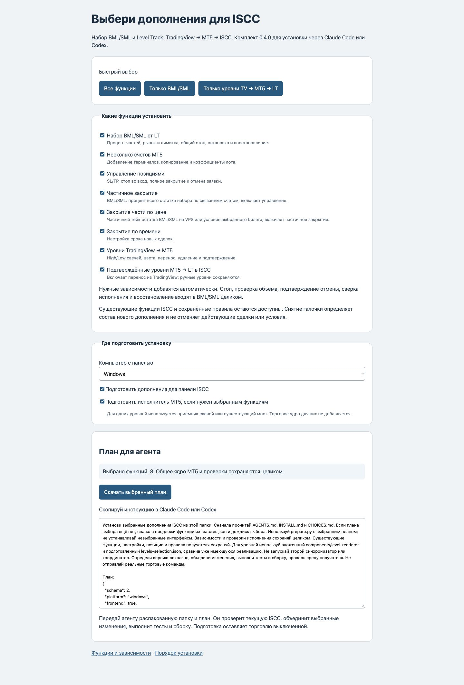

## 02 · Выбрать процент части для SPX

В настройках **Level Orders** задайте **chunkPercent**: общее значение в defaults или отдельное для своего символа SPX в symbols. Допустимы значения больше 0 и до 100%, включая дробные. Настройка символа имеет приоритет над общей.

 Схема · условные значения

### Целевой объём = 100%

 30%  30%  30%  10%

chunkPercent = 30 → доли от первоначального целевого объёма.

 25%  25%  25%  25%

Переопределение для SPX: chunkPercent = 25 → примерно четыре части.

**Результат:** новый вход использует выбранное деление. Процент очередной части считается от полного целевого объёма. Шаг и минимальный лот брокера, а также предел лота одной части могут изменить фактическое деление. Нажатие BML/SML запускает уже торговое задание.

## 03 · LT → BML или SML → ожидание

Проверьте символ, уровень LT, денежный риск, стоп и тейк в карточке. В примере SPX500: LT = 7366,28; значения 300/900 в полях стопа и тейка заданы в шагах цены. При шаге 0,01 это расстояния 3/9 пункта.

**BML** — покупка: проверяется Ask в диапазоне [LT; LT + люфт]. **SML** — продажа: проверяется Bid в диапазоне [LT − люфт; LT]. Границы включены. С другой стороны уровня алгоритм ожидает возврата цены.

**BML · BUY**

LT 7366,28; люфт 1,00 · Ask: 7366,28 … 7367,28

**SML · SELL**

LT 7366,28; люфт 1,00 · Bid: 7365,28 … 7366,28

**Результат:** карточка показывает состояние задания. «Ожидание» и 0% означают, что подтверждённого набора пока нет. «Снять ожидание» отменяет ещё не начатый вход.

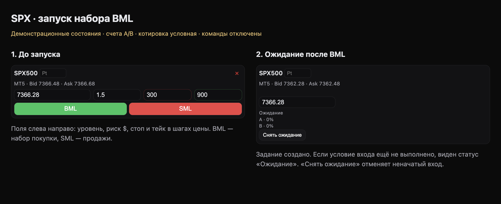

## 04 · Набор, лимитка и независимые счета

По мере подтверждения сделок растёт процент каждого счёта. На снимке A набрал 40%, B — 37%. Статус «Лимитка» указывает на поддержку ненабранного остатка ожидающей заявкой.

Объём рыночной части резервируется; лимитке достаётся свободный остаток. Перед следующим действием учитываются исполнение прежней лимитки и подтверждение её отмены. Свежесть цены проверяется на стороне MT5.

**Результат:** каждый счёт набирает свой целевой объём. Завершивший набор счёт не получает лишние части ради отстающего. «Набор завершён» относится к достижению объёма; позиция остаётся открытой. Кнопка **T|S** открывает управление именно этим набором, в том числе пока набор ещё идёт.

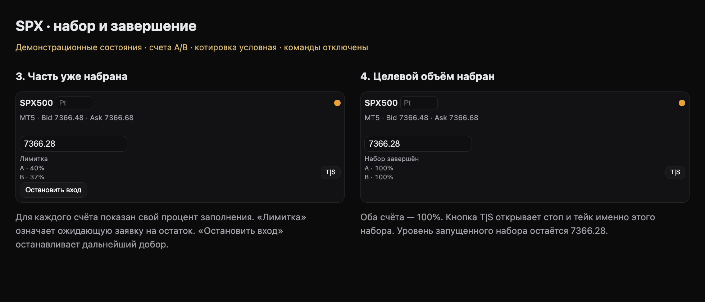

## 05 · Остановить добор

В активной карточке нажмите **«Остановить вход»** и дождитесь подтверждения остановки и снятия остаточной лимитки. Кнопка показана слева на предыдущем снимке.

 Схема действия

 Остановить вход **→** Прекратить добор · и снять остаточную лимитку **→** Открытые части · и их SL сохраняются

**Результат:** новые части больше не добавляются. Для выхода из уже открытого объёма используйте частичное или полное закрытие. После перезапуска автоматического нового входа нет: сначала сверяется сохранённое состояние.

## 06 · Перенести стоп и тейк на графике

Откройте **T|S** в карточке либо «Позиции · MT5», выберите нужный набор и счета. На графике показаны 30 минутных баров MT5, средняя цена входа и уровни защиты.

- Выберите SL или TP и перетащите линию либо введите точную цену в поле.

- Для дальнего тейка нажмите его метку вне шкалы или расширьте масштаб.

- Проверьте счёт и режим «SL/TP на всех счетах», затем нажмите **«Сохранить»**.

- Дождитесь результата и проверьте фактические SL/TP после обновления.

Кнопки +/− меняют масштаб, «Авто» возвращает автоматическую шкалу. Дальний TP может отображаться отдельной меткой вне шкалы.

 Схема общего стопа · условный BUY

LT = 7366,28; средняя входа = 7366,68; расстояние стопа = 3 пункта.

**Стоп от LT · level**

7366,28 − 3 = **7363,28**

**Стоп от средней · entry**

7366,68 − 3 = **7363,68**

Режим задаётся перед новым набором. Средняя цена может отличаться по счетам; денежный риск зависит от фактического исполнения.

**Результат:** перенос линии сначала меняет черновик. Команда отправляется после сохранения. Для BML/SML управление относится к частям выбранного набора. Общий стоп может рассчитываться от средневзвешенной цены частей каждого счёта либо относительно LT — согласно режиму входа.

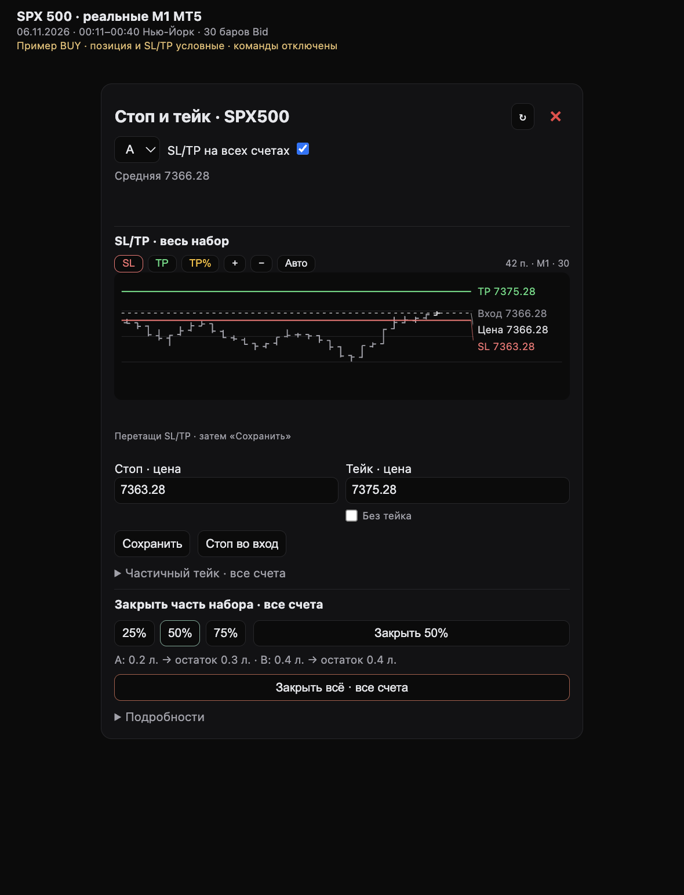

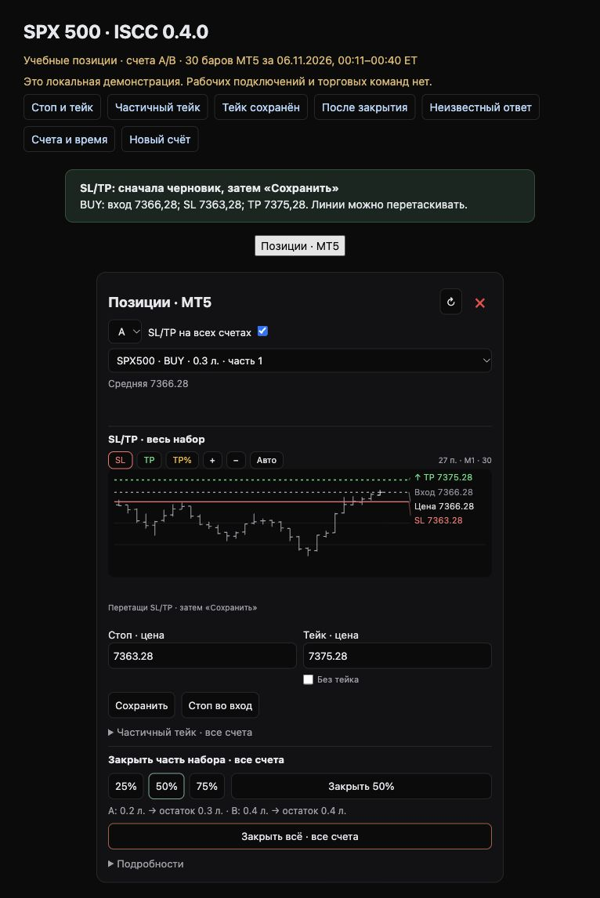

## 07 · Стоп во вход

Нажмите **«Стоп во вход»**. В поле стопа появится средняя цена набора; затем нажмите **«Сохранить безубыток»**.

**Результат:** при сохранении исполнитель заново проверяет среднюю цену отдельно на каждом выбранном счёте. В учебном примере это 7366,28. Название кнопки означает перенос к средней цене входа; комиссии, своп и проскальзывание могут оставить денежный результат отличным от нуля.

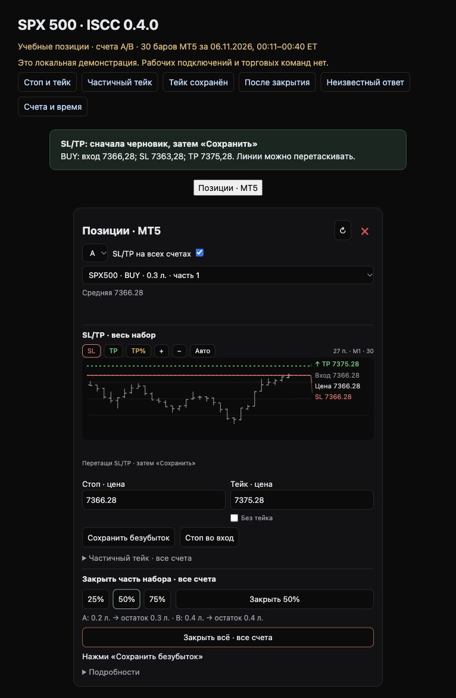

## 08 · Убрать обычный тейк

Включите **«Без тейка»**, проверьте стоп и выбранные счета, затем нажмите **«Сохранить»**. Пока сохранения нет, это черновик.

**Результат:** обычный TP снимается на выбранных счетах. Для возврата снимите галочку, задайте цену и сохраните. Отдельный частичный тейк набора отменяется своей кнопкой в его разделе.

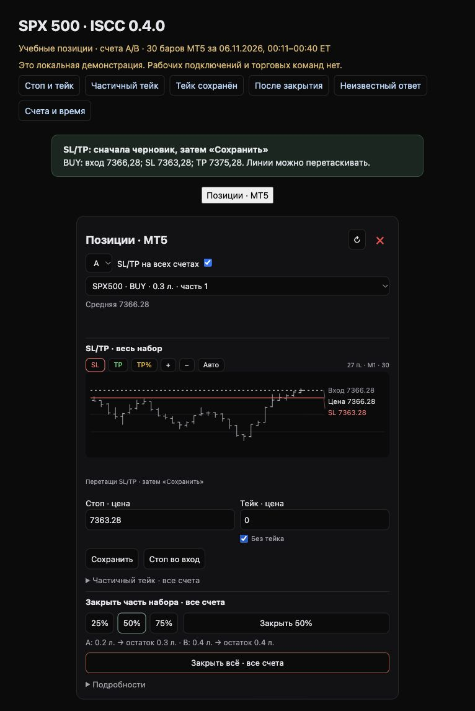

## 09 · Закрыть часть сейчас

В разделе **«Закрыть часть набора»** выберите 25%, 50% или 75%. Перед нажатием «Закрыть …%» прочитайте строку лотов и остатка.

Для своего значения раскройте **«Подробности» → «Другой объём»**, выберите «% позиции» и задайте «Закрыть · %». Для BML/SML этот процент по-прежнему относится ко всему остатку набора. Перед отправкой проверьте обновлённый расчёт лотов.

**Для BML/SML:** процент относится ко всему текущему остатку этого набора отдельно на каждом связанном счёте. Фактические лоты учитывают шаг и минимум брокера, поэтому выбранный процент может получиться приблизительным.

| Пример на снимке · 75% | Остаток до | Закрыть | Останется |
| --- | --- | --- | --- |
| A | 0,5 л. | 0,3 л. | 0,2 л. |
| B | 0,8 л. | 0,6 л. | 0,2 л. |

**Результат:** после подтверждения закрытия уменьшается открытый остаток. Это рыночное действие; фактическая цена исполнения зависит от рынка. Для обычной позиции вне BML/SML доступны лоты или процент выбранной позиции; лоты относятся к выбранному билету.

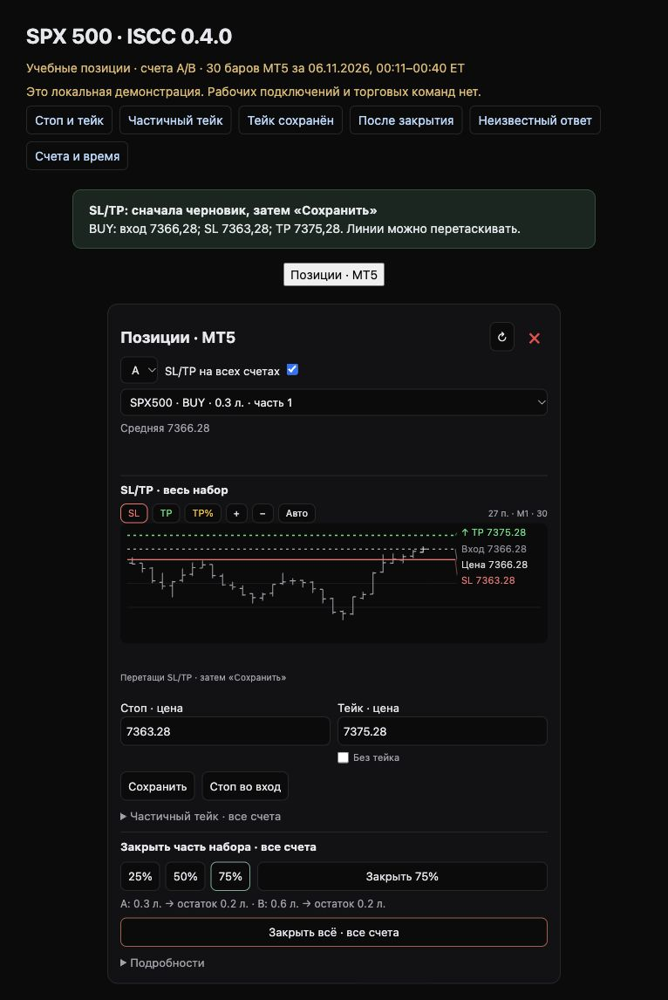

## 10 · Закрыть часть при достижении цены

- Раскройте **«Частичный тейк · все счета»**.

- Укажите цену, например 7370,78, и процент остатка, например 50%. Для подготовки цены можно выбрать TP% на графике и перенести линию.

- Проверьте предварительные лоты и нажмите **«Сохранить TP 50%»**.

- Убедитесь, что по счетам появился статус **«ожидает цену»**.

**Результат:** условие хранится на VPS и обслуживается при закрытой панели Mac. Для BUY проверяется Bid, для SELL — Ask. При срабатывании отправляется рыночное закрытие доли текущего остатка; цена условия не гарантирует цену исполнения. Обычные SL/TP сохраняются.

Пока условие ожидает цену, его можно отменить кнопкой **«Отменить частичный тейк»**. Уже отправленное закрытие или неизвестный ответ требуют сверки. Нужна поддержка частичного тейка набора в установленном исполнителе.

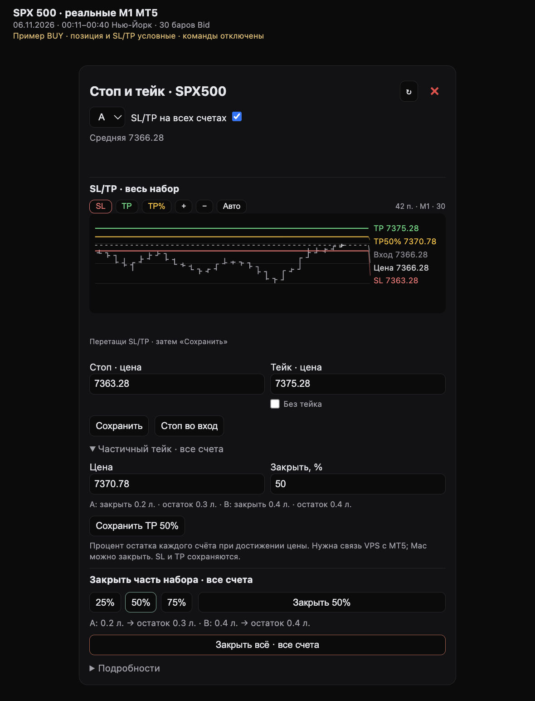

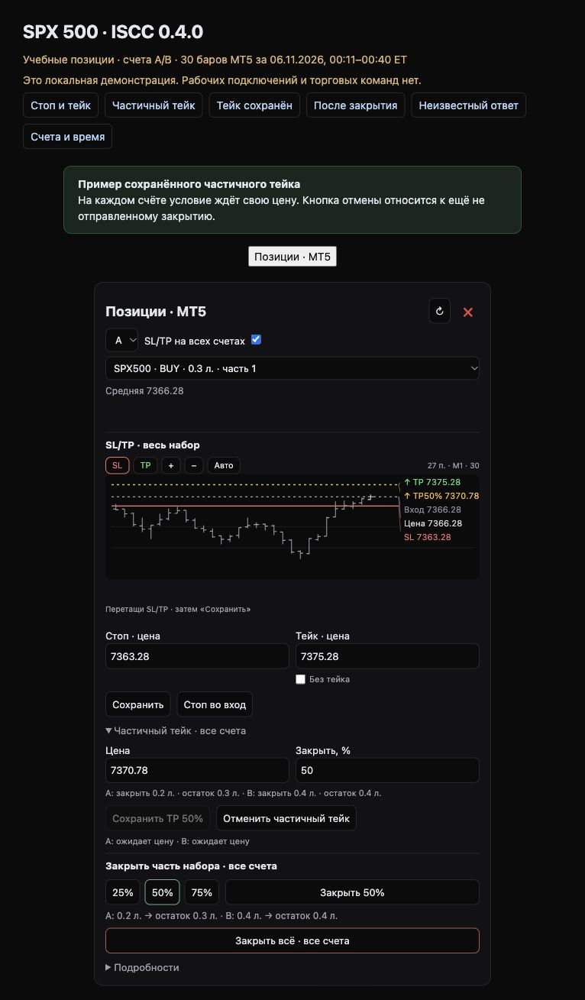

## 11 · Полностью закрыть набор

Проверьте выбранный набор и счета. Нажмите **«Закрыть всё · все счета»** — кнопка видна в полной панели и на снимке частичного закрытия. Дождитесь подтверждения закрытия и отмены относящейся к набору остаточной заявки.

Полное закрытие BML/SML охватывает все связанные счета этого набора. Галочка «SL/TP на всех счетах» задаёт охват изменения защиты; она не ограничивает полное закрытие набора одним счётом.

**Результат:** у этого набора не остаётся открытого объёма. В учебном примере других позиций нет, поэтому список пуст. Сообщение «Позиций и заявок нет» на снимке — заранее заданное состояние для объяснения результата.

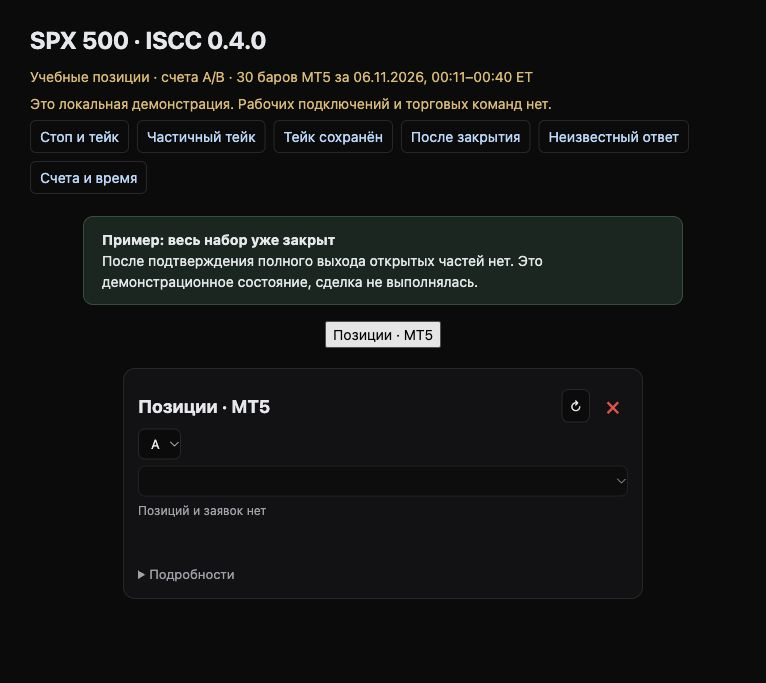

## 12 · Подключить несколько счетов MT5

- Войдите в дополнительный счёт в отдельном терминале MT5 на Windows, где работает совместимый исполнитель.

- Откройте **«Счета и время · MT5» → «Найти терминалы на VPS»**.

- Проверьте найденный счёт и нажмите **«Добавить счёт»**.

- После подтверждения включите копирование, задайте коэффициент лота и нажмите **«Сохранить коэффициенты»**.

**Результат:** новые входы используют выбранные счета и множители. Добавление счёта само по себе ещё не включает копирование. ×1 — тот же целевой лот, ×0,7 — 70%, ×1,6 — 160% основного с учётом шага и минимума лота. В версии 0.4.0 коэффициент задаётся вручную и автоматически по балансу не рассчитывается.

Автоматическое добавление требует поддерживаемого брокерского сервера и совместимых символов. MT4 в этом комплекте доступен для подготовки подключения; торговое копирование MT4 ещё не включено.

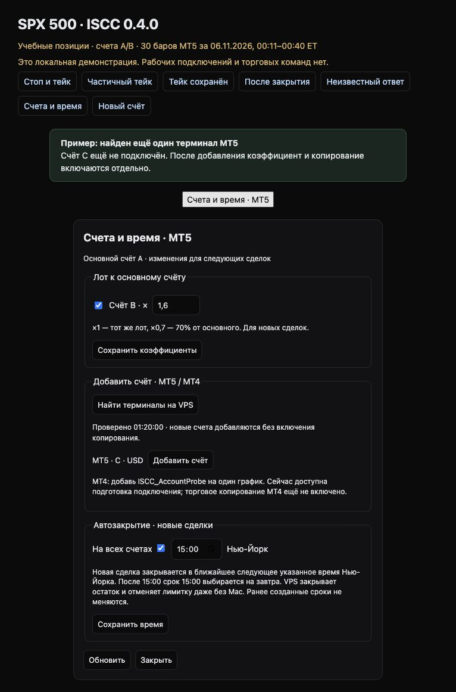

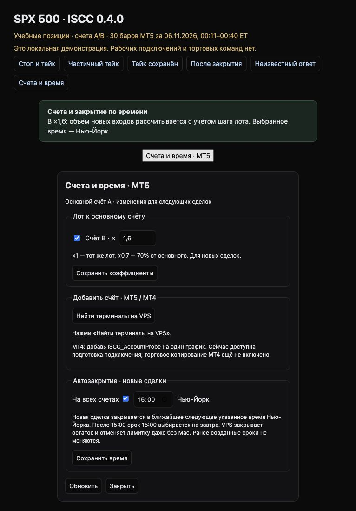

## 13 · Закрывать новые сделки по времени

В нижней части окна **«Счета и время · MT5»** включите автозакрытие, задайте время Нью-Йорка и нажмите **«Сохранить время»**. На предыдущем снимке выбрано 15:00.

**Результат:** новая сделка получает ближайшее следующее указанное время. Если 15:00 сегодня уже прошло, срок выбирается на завтра. Исполнитель закрывает остаток и отменяет лимитку даже без открытой панели Mac. Настройка действует на новые сделки; ранее созданные сроки сохраняются.

## 14 · Если ответ не подтверждён

Сообщение **«Есть неподтверждённая команда… Повтор заблокирован»** означает, что результат ещё сверяется. Дождитесь сверки; кнопка «Обновить позиции» читает текущее состояние.

**Результат:** повторная команда для того же набора блокируется, чтобы не закрыть или не открыть лишний объём из-за потерянного ответа. Видимая блокировка сама по себе не сообщает, исполнилась ли первая команда: это выясняется по подтверждениям MT5.

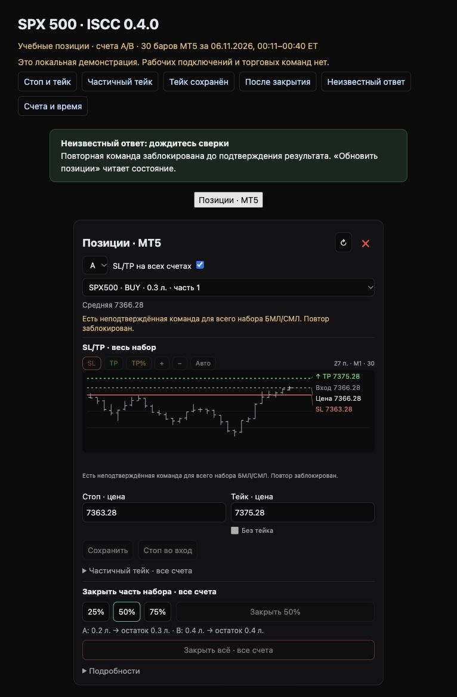

## 15 · TradingView → MT5 → LT → карточка SPX

Схема передачи уровня

 TradingView · High/Low закрытой свечи **→** MT5 · Точная свеча и цена брокера **→** Индикатор · Подтвердил отрисовку **→** LT в ISCC · Обновил уровень

- Настройте точную пару символов SPX у источника TradingView и принимающего MT5.

- Передайте High или Low закрытой свечи. Сохраняются период, время и сторона свечи; соседняя свеча не подставляется.

- Проверьте уровень на открытом графике MT5 и подтверждение индикатора.

- При включённом MT5 → LT проверьте обновление уровня в LT и незапущенной карточке.

**Результат:** используются цены соответствующей свечи MT5, поэтому число может отличаться от TradingView. Изменения, цвет и удаление передаются дальше: белые отметки TV отображаются красными, красные — фиолетовыми. Ручные объекты MT5 и ручные группы LT сохраняются.

На снимке незапущенная карточка меняется с 7366,28 на 7367,28. **Уже запущенный набор сохраняет исходный LT**. При выключенном MT5 → LT отрисовка в MT5 продолжает работать. Для одних уровней торговые дополнения можно не устанавливать.

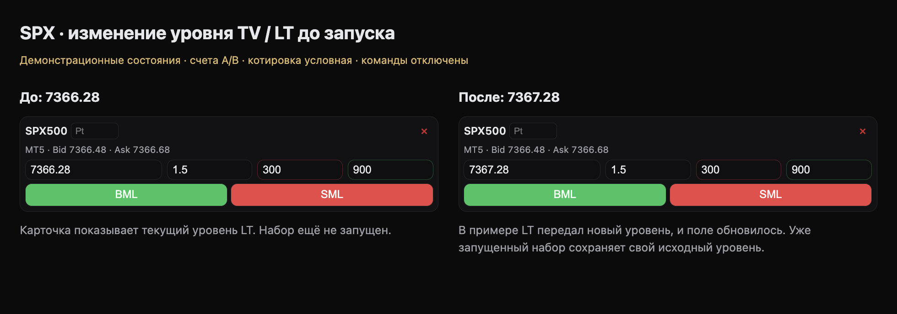
